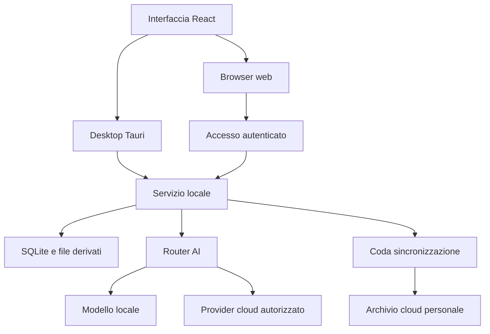

# Architettura proposta
Stato: proposta tecnica v0.1 da validare. I vincoli local-first, desktop/web e AI ibrida sono confermati; stack e strategie sottostanti sono scelte proposte, non decisioni già approvate.

## Componenti
Frontend condiviso React e TypeScript; contenitore desktop Tauri; servizio applicativo Python/FastAPI per catalogo, didattica e AI; SQLite per dati locali. Originali esterni in sola lettura, copie derivate e indici in directory dell'app. Ricerca full-text iniziale; indice vettoriale locale sostituibile e ricostruibile da chunk e versioni. Nessun obbligo di microservizi nel prodotto personale.

Il diagramma rappresenta il browser connesso al servizio della macchina personale tramite accesso autenticato. Un browser remoto non può leggere direttamente SQLite o percorsi locali. MVP: web locale sulla stessa macchina. Accesso da altri dispositivi e archivio cloud arrivano con R10 e richiedono autenticazione e trasporto cifrato. Se si richiede web autonomo offline con PC spento, servono storage browser, cache e sync dedicati: estensione esplicita, non promessa implicita del frontend condiviso.

## Modalità operative
Desktop senza rete: materiali già importati, note, quiz, ripasso e modello locale se installato. Senza modello disponibile: funzioni deterministiche utilizzabili e tutor non disponibile con messaggio chiaro. Web locale: stesso backend sulla macchina. Web remoto: solo dopo hardening e autenticazione. Nessuna esposizione pubblica automatica della porta locale.

## Pipeline materiali
Scansione → hash → classificazione → estrazione → controllo qualità/OCR → segmentazione → indicizzazione → associazione obiettivi → revisione. Ogni fase ha job id, stato, tentativi, errori e possibilità di ripresa. Rilevare file duplicati per hash; varianti editoriali con identità distinta. `OLD_COPY` non viene cancellato né sostituito automaticamente. File cache/log e dataset binari non vengono inviati al tutor come testo didattico.

Fonti PDF: pagina fisica e, se disponibile, pagina stampata; Word: heading e paragrafo; notebook: indice cella e hash; Python: righe e hash versione. Mai inventare numeri di pagina da un estratto Word. Testo OCR con confidence e stato revisione: formule non verificate escluse dalla banca quiz valutativa.

## Modello dati minimo

| Entità | Campi essenziali e vincoli |
|---|---|
| Source | id, provider, locator, read_only, scope autorizzato |
| MaterialVersion | id, material_id, source_revision, sha256, tipo, stato estrazione; immutabile |
| Chunk | id, version_id, locator, testo, qualità, index_version |
| Objective | id, curriculum_version, prerequisiti; grafo senza cicli |
| ExamBlueprint | provider, codice, versione, checked_at, fonte; stato corrente/ritirato |
| ObjectiveEvidence | objective_id, version_id, locator, copertura, revisione |
| QuestionVersion | id, objective_id, prompt, opzioni, soluzione, rationale, fonti, revisione |
| Attempt | UUID, device_id, question_version_id, risposta, score, timestamp; append-only |
| ReviewState | objective_id, algoritmo_versione, due_at; ricostruibile dai tentativi |
| NoteVersion | id, note_id, base_version, contenuto, device_id; conflitti conservati |
| AIUsage | job_id, modello, token, costo stimato/effettivo, policy, stato |
| SyncEvent | UUID, entity_id, base_revision, payload_version, stato ack |

Chiavi esterne attive e migrazioni versionate. Distinguere fonte assente, estrazione fallita, indicizzazione incompleta e materiale pronto. La cancellazione di una fonte non riscrive gli score storici: conservare locator/versione come riferimento non più disponibile.

## Contratti API proposti

| Operazione | Contratto |
|---|---|
| POST /imports | source_id e idempotency_key; ritorna job_id, mai esegue il codice importato |
| GET /jobs/{id} | fase, progress, error_code e possibilità di ripresa |
| GET /materials | filtri tipo/topic/stato e paginazione |
| GET /materials/{id}/versions/{version}/chunks | estratti e locator della versione richiesta |
| POST /study-sessions | obiettivi e modalità, ritorna session_id |
| POST /attempts | UUID client e question_version_id; replay restituisce lo stesso risultato |
| POST /tutor/messages | session_id, domanda, policy locale/cloud, limite spesa |
| GET /reviews/due | ripassi ordinati con motivazione |
| POST /exports | archivio con versione schema e manifest |
| POST /sync/push e GET /sync/pull | eventi idempotenti e cursore opaco, solo nella fase sync |

Risposte errore: code, messaggio leggibile, retryable, request_id. I client non inviano score come dato autorevole; la correzione si calcola dal quesito versionato. Autorizzazione per profilo su ogni risorsa remota; token locale e verifica origin/host per servizio desktop. CORS da solo non è autenticazione.

## Tutor e costi
Recuperare contesto locale con filtri di versione e qualità; produrre risposta con riferimenti controllabili. Modalità: solo locale, cloud consentito per sessione o nessuna AI. Nessun fallback cloud silenzioso se la modalità è locale. Redigere solo estratti necessari, non interi libri; mascherare credenziali e dati personali. I documenti recuperati non possono attivare strumenti o cambiare policy.

Budget configurabile per richiesta/giorno/mese; nessuna cifra assunta come autorizzata. Prenotare atomicamente il costo massimo stimato prima della chiamata, con limite output; riconciliare dopo risposta ed evitare sforamenti tra chiamate concorrenti. Tariffe versionate con data; cache legata a modello, prompt, corpus e policy. Retry solo per errori transitori con chiave job, senza moltiplicare automaticamente spesa.

## Sync e protezione
Dati locali autorevoli per l'operatività offline. Tentativi append-only uniti per UUID; note con controllo base_revision e copie in conflitto, nessun last-write-wins distruttivo. Preferenze con revisione; cancellazioni tramite tombstone. Il server conferma eventi applicati; interruzioni riprendono dall'ultimo ack. Timestamp UTC, visualizzazione Europe/Rome. Cifratura in transito; segreti in keychain desktop o vault server, mai nel browser bundle. Cifratura a riposo e gestione chiavi da validare prima del remoto; non dichiarare end-to-end finché non progettata e provata.

Backup consistente SQLite tramite API di backup, file derivati e manifest; indici ricostruibili. Testare il restore su profilo pulito prima di una migrazione. Esecuzione esercizi separata dal backend con ambiente senza privilegi, rete disabilitata di default, limiti CPU/RAM/tempo e nessun volume con credenziali. Modelli pickle importati non vengono caricati dal processo applicativo.
