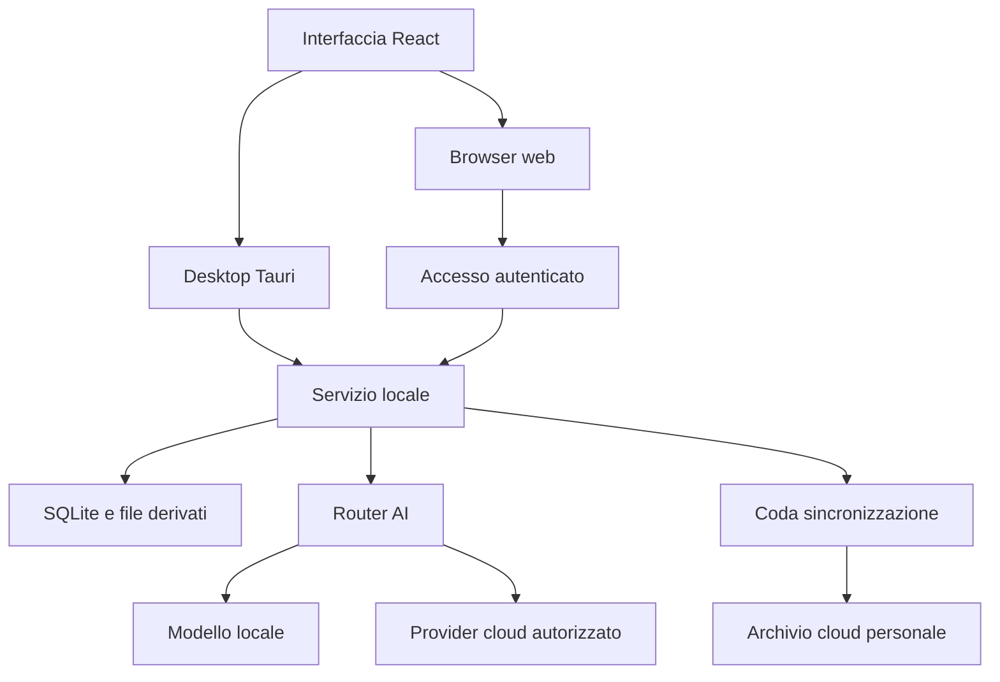

# DeepStudy — Documentazione progettuale v0.1

26 novembre 2026 • Stato: in revisione


---

# DeepStudy — AI-Powered ML & DL Certification Academy
Documentazione progettuale v0.1 • 26 novembre 2026 • Italiano

## Stato e lettura
Questa versione rende revisionabili analisi, curriculum e proposta tecnica. Non autorizza né avvia l'implementazione dell'app. I requisiti recuperati dagli accordi precedenti sono separati dalle scelte progettuali proposte in questa versione.

| Documento | Contenuto |
|---|---|
| [01-analisi-materiali.md](01-analisi-materiali.md) | Inventario verificato, contenuti, livelli e limiti |
| [02-certificazioni-gap.md](02-certificazioni-gap.md) | Obiettivi aggiornati e lacune rispetto ai programmi |
| [03-curriculum.md](03-curriculum.md) | Percorso, prerequisiti, prove e progetti |
| [04-requisiti-prodotto.md](04-requisiti-prodotto.md) | Funzioni, priorità e criteri di accettazione |
| [05-architettura.md](05-architettura.md) | Componenti, dati, API, sincronizzazione e AI |
| [06-milestone.md](06-milestone.md) | Task, dipendenze, verifiche e risultati attesi |
| [07-istruzioni-agenti.md](07-istruzioni-agenti.md) | Prompt per ChatGPT, Codex, Claude Code e Cursor |
| [08-decisioni-validazione.md](08-decisioni-validazione.md) | Decisioni consolidate e questioni aperte |
| [09-fonti.md](09-fonti.md) | Riferimenti ufficiali e provenienza |
| evidenze/inventario-completo.csv | Tutti i 13.327 file del repository con hash |
| evidenze/analisi-sorgenti.json | Schede dei sorgenti e profili dei dati |
| evidenze/riepilogo.json | Conteggi e commit di riferimento |
| evidenze/pdf-ocr.txt | OCR delle 11 pagine dei 10 cheatsheet, da verificare |

## Perimetro effettivamente verificato
Repository `romy1992/studyIA`, branch main, commit `d9e53d872d536fa53a0efd1f194b03b2d1d84b67`: inventario completo, lettura statica di tutti i Python e delle celle sorgente dei notebook, profilo strutturale CSV/TSV, estrazione testo e OCR dei cheatsheet. Nessun esercizio eseguito. Nessuna modifica agli originali.

Drive: elencate le cartelle IA, Parte 1°, Parte 2°, Parte 3°, Certificati ed Esercizi Domande e Risposte. Letti tramite estrazione testuale i quattro Word principali, Appunti Studi IA e il documento di domande/risposte. Non verificati integralmente layout, immagini, formule e duplicati PDF; certificati soltanto inventariati. L'analisi resta da chiudere su questi aspetti: non si dichiara una revisione integrale di ogni pagina dei libri.

## Risultato principale
La raccolta sostiene bene lo studio dei fondamenti e del ML classico; contiene anche esempi DL. La preparazione professionale richiede laboratori aggiuntivi di gestione del ciclo di vita, deployment, osservabilità, piattaforme cloud e AI generativa. La presenza di materiale non dimostra la padronanza personale: la misuriamo con diagnostica e prove pratiche.


---

# Analisi dei materiali

## Metodo e tracciabilità
Snapshot GitHub del 26/11/2026, commit indicato nel README. Inventario per percorso, formato, dimensione, SHA-256, argomenti e stato di lettura. Notebook analizzati nelle celle sorgente, senza eseguire output o import. CSV e TSV profilati contando record dopo la prima riga e registrando la prima riga; alcuni dataset non hanno intestazione. Modelli pickle/Keras, archivi e file di log sono inventariati, non deserializzati.

I tag automatici sono indizi, non valutazioni definitive. In particolare la ricerca della parola `transformers` produceva tre falsi positivi dovuti a `ColumnTransformer`: non documentano LLM. Nessuna evidenza di un laboratorio RAG o di MLOps nei sorgenti individuati. Le stime di difficoltà sotto sono valutazioni didattiche, non misure dell'abilità dell'utente.

## Inventario GitHub

| Tipo | Numero | Utilizzo |
|---|---:|---|
| Python | 163 | Esercizi, implementazioni, alcuni file inizializzazione vuoti |
| Notebook | 38 | ML classico e reti neurali, incluse varianti refactored |
| PDF | 10 | Cheatsheet, 11 pagine complessive |
| CSV | 74 | Dataset, più copie tra esercizi |
| TSV | 1 | Dataset NLP |
| JPG | 10.002 | Asset del dataset di immagini, non lezioni distinte |
| PNG / JPEG | 6 / 1 | Figure e asset |
| Pickle / Keras | 9 / 1 | Modelli serializzati; non caricati |
| Altri file | 3022 | Include cache, log, archivi e altri asset |
| **Totale** | **13.327** | Il CSV completo permette controlli per singolo file |

Il repository non contiene file Word o PowerPoint nello snapshot. I libri Word sono su Drive. Il numero di script non equivale al numero di lezioni originali: ci sono file vuoti e duplicati da raggruppare per hash durante l'importazione.

## Collezioni e competenze

| Percorso | Contenuti verificati nei sorgenti | Livello stimato | Impiego |
|---|---|---|---|
| lesson-1-Preprocessing | Imputazione, codifica, scaling | Base | Fondamenti dei dati |
| lesson-2-Regression | Lineare, polinomiale, SVR, alberi e foreste | Base/intermedio | Confronto modelli e metriche |
| lesson-3-Classification | Logistica, KNN, SVM, Bayes, alberi | Base/intermedio | Classificazione e valutazione |
| lesson-4-Clustering | K-means e gerarchico | Intermedio | Segmentazione |
| lesson-5-Association Rule Learning | Regole associative | Intermedio | Modulo complementare |
| lesson-6-Reinforcement Learning | UCB e Thompson sampling | Intermedio | Bandit; non equivale a RL profondo |
| lesson-7-Natural Language Processing | NLTK, bag-of-words, Naive Bayes | Base/intermedio | Baseline NLP |
| lesson-8-Deep Learning | ANN, CNN, RNN e dati immagine | Intermedio | Progetti DL |
| lesson-9-Dimensionality Reduction | PCA e riduzione supervisionata/non supervisionata | Intermedio | Rappresentazioni |
| lesson-10-Model Selection | Cross-validation e ricerca iperparametri | Intermedio | Selezione corretta |
| Hands On Machine Learning… | Capitoli 2–15 presenti in parte; pipeline, ensemble, personalizzazioni Keras, dati e sequenze | Intermedio/avanzato | Percorso principale pratico |
| apogeo/manning-master | Grokking Machine Learning: regressione, perceptron, Bayes, alberi, ensemble, NN | Base/intermedio | Spiegazioni intuitive e implementazioni |
| mix-exercise | Esercizi trasversali | Da graduare per esercizio | Diagnostica e consolidamento |

## Cheatsheet
OCR effettuato su tutte le pagine, con possibili errori su formule e grafici. 1: rami ML; 2: algoritmi DL; 3: architetture neurali, SOM, autoencoder e RBM; 4: algoritmi AI e MDP; 5: domini data science; 6: ciclo progetto; 7: R/Python; 8: strumenti statistici; 9: competenze data science; 10: sistemi database. Utili al ripasso, insufficienti come programma o prova di competenza. Le trascrizioni OCR restano da verificare visivamente prima di generare domande basate sulle formule.

## Drive: libri e appunti

| Materiale | Evidenza | Uso e cautele |
|---|---|---|
| Hands-On ML, Géron, seconda edizione | Word estratto: frontespizio 2019 e indice ML/DL; PDF e OLD_COPY elencati | Testo principale; confrontare esempi con API attuali. Non usare OLD_COPY come canonico |
| AI and Machine Learning for Coders, Moroney | Word estratto: edizione 2020, TensorFlow, vision, NLP e distribuzione | Dopo basi ML e Géron, come preferenza già espressa |
| Deep Learning with Python, Chollet | Word estratto: copyright 2018, tensori, gradienti, Keras, vision e sequenze | Fondamenti DL; il nome ITA non garantisce testo tradotto: l'estrazione contiene inglese |
| Deep Learning, Goodfellow/Bengio/Courville | Word estratto: algebra, probabilità, ottimizzazione, reti e modelli generativi | Riferimento teorico avanzato, lettura selettiva; anno nel titolo non assunto come edizione verificata |
| Appunti Studi IA | Estratto con EDA, split, leakage, pipeline, CV e tuning | Collegare ai concetti; conservare note originali |
| Esercizi Domande e Risposte | Testo letto: domande introduttive e risposte personali | Generare revisione ragionata; non assumere corrette le risposte |
| Tre PDF Coursera in Certificati | Nomi e metadati elencati | Non dedurre corsi o competenze senza leggere i certificati |
| Stime | Foglio elencato | Contenuto non analizzato in questa versione |

Esempio da correggere nella didattica: la risposta sulla segmentazione con gruppi noti cita «anche Lineare». Con classi note si tratta normalmente di classificazione supervisionata; regressione lineare non è la risposta generale. La correzione deve avere spiegazione e riferimento, conservando la risposta originale.

## Limiti e completamento
Restano da controllare formule/immagini dei libri, equivalenza tra Word/PDF, certificati, foglio Stime e riproducibilità degli esercizi. La futura scansione dovrà escludere cache e log dall'indice didattico mantenendoli nel manifest. Non assegnare percentuali di copertura certificativa dal conteggio dei file. I dati originali restano in sola lettura; ogni adattamento vive in una copia di lavoro separata.


---

# Certificazioni e gap analysis
Verifica fonti ufficiali: 26 novembre 2026. È una mappatura per dominio; la mappatura di ogni singolo obiettivo delle guide deve essere completata e versionata prima di dichiarare un percorso pronto all'esame.

## Obiettivi
Databricks ML Associate e AWS ML Engineer erano priorità proposte, non ancora scelte esplicitamente dall'utente. Proposta di lavoro: nucleo comune, poi una sola specializzazione iniziale per contenere costi e dispersione; Google e Azure come percorsi successivi o alternativi.

| Percorso | Stato verificato | Conseguenza |
|---|---|---|
| Databricks Certified Machine Learning Associate | Pagina ufficiale disponibile; aree piattaforma, workflow, sviluppo e deployment [S1] | Candidato iniziale; servono laboratori Databricks/MLflow/Unity Catalog |
| AWS Certified Machine Learning Engineer – Associate | Guida MLA-C02 in uso dal 29/09/2026 [S2] | Usare C02: include anche foundation model e RAG |
| Google Professional Machine Learning Engineer | Pagina corrente include ML e AI generativa, pipeline e produzione [S3] | Percorso avanzato; recuperare la nuova guida collegata prima della matrice per obiettivo |
| Microsoft Machine Learning Operations Engineer Associate | Pagina corrente: MLOps e GenAIOps, Azure ML e Foundry [S4] | Possibile percorso Azure; non sostituire automaticamente una preferenza dell'utente |
| TensorFlow Developer Certificate | Esame chiuso [S5] | TensorFlow resta competenza tecnica; rimuovere obiettivo di prenotazione |
| Azure AI Engineer Associate / Azure Data Scientist Associate | Ritirati il 30/06/2026 e 01/06/2026 [S6] | Non pianificarli come nuovi esami |

Fonti S1–S6 e URL in 09-fonti.md. Non sono state verificate qui altre certificazioni NVIDIA: nessun programma specifico viene assunto come requisito. Corsi DeepLearning.AI/fast.ai sono risorse formative, non equivalenti a certificazioni professionali con esame sorvegliato.

## Confronto Databricks per domini
Pesi della pagina ufficiale: piattaforma 38%, workflow 19%, sviluppo 31%, deployment 12% [S1].

| Dominio | Evidenza interna | Copertura qualitativa | Integrazione e prova |
|---|---|---|---|
| Databricks ML | Python e notebook generici | Piattaforma non dimostrata | AutoML, Unity Catalog, MLflow: eseguire un esperimento e registrarne gli artefatti |
| ML workflows | Preprocessing, split e pipeline sklearn; appunti leakage | Parziale, trasferibile | Portare pipeline in workflow tracciabile con feature e lineage |
| Model development | Regressione, classificazione, ensemble e CV | Buona base concettuale, non validata in esecuzione | Tuning tracciato e confronto con baseline su holdout |
| Model deployment | Modelli serializzati presenti | Operatività non dimostrata | Registrazione, serving, gestione versione e test inferenza |

## Confronto AWS MLA-C02
I quattro domini correnti pesano 28%, 24%, 24%, 24% [S2].

| Dominio | Evidenza interna | Gap principale | Laboratorio |
|---|---|---|---|
| Preparazione dati ML/AI | CSV, encoding, scaling, pipeline | Storage/ingestion AWS, embedding, dati RAG e protezione dati | Pipeline dati con ruoli minimi, validazione e tracciamento |
| Sviluppo ML e foundation model | sklearn e Keras; NLP classico | SageMaker/Bedrock, selezione FM, RAG e valutazione generativa | Confrontare baseline ML e un caso RAG con dataset di valutazione |
| Deployment e orchestrazione | Esempi locali | Endpoint, pipeline gestite, CI/CD e infrastruttura | Deploy riproducibile, test e rollback |
| Operazioni, monitoraggio e sicurezza | Appunti concettuali | Metriche operative, drift, IAM e gestione costi | Simulare drift, allarme, recupero e rimozione risorse |

## Google e Azure: confronto preliminare
Google valuta architettura low-code, collaborazione su dati/modelli, scala, serving, orchestrazione e monitoraggio [S3]. I sorgenti sostengono soprattutto prototipazione e modellazione: mancano evidenze operative sulla piattaforma. La pagina segnala aggiornamenti di piattaforma: evitare programmi basati su una vecchia guida o solo sui nomi storici dei servizi.

Azure richiede infrastruttura MLOps/GenAIOps, ciclo di vita, qualità, osservabilità e ottimizzazione [S4]. Mancano laboratori dimostrati con Azure ML, Foundry, GitHub Actions e IaC. La copertura teorica del DL non colma questi requisiti.

## Gap trasversali ordinati

| Priorità | Lacuna | Risorsa ufficiale da integrare | Evidenza richiesta |
|---|---|---|---|
| P0 | Diagnosi competenze e leakage | sklearn User Guide [S7] | Pipeline fit solo sui fold train, holdout separato |
| P0 | Riproducibilità | Guide framework [S7–S9] | Ambiente bloccato, seed e istruzioni di esecuzione |
| P0 | MLOps | MLflow docs e guida del percorso scelto [S10] | Run, registro modello, serving, rollback |
| P0 | Piattaforma d'esame | S1 oppure S2 e relativi percorsi ufficiali | Laboratorio completo con evidenze |
| P1 | LLM, embedding, RAG e valutazione | Guide correnti del provider scelto | Test retrieval e groundedness, costo e latenza |
| P1 | Monitoring, sicurezza, governance | Guide del provider scelto | Drift simulato, autorizzazioni e audit |
| P1 | PyTorch | Tutorials ufficiali [S9] | Training loop, checkpoint e inferenza |
| P2 | Matematica e teoria avanzata | Libro Goodfellow già presente | Derivazione e spiegazione applicata |

«Non dimostrata» significa assenza di evidenza sufficiente nel materiale esaminato, non incapacità personale. Completare la matrice con `exam_version`, `objective_id`, `material_id`, `evidence_locator`, stato, confidence, laboratorio e data controllo. Evitare percentuali di copertura finché ogni obiettivo non ha evidenza revisionata.


---

# Curriculum professionale

## Struttura
Percorso progressivo, con diagnostica iniziale: esperienza di sviluppo software non equivale automaticamente a padronanza ML. L'ordine conserva la preferenza per fondamenti/Andrew Ng, Géron e progetti prima di Moroney. Le ore sotto sono stime progettuali di lavoro attivo, da ricalibrare dopo la diagnostica; non sono durate ufficiali o garanzie di superamento.

| Modulo | Prerequisito | Competenze e materiali | Prova finale | Ore stimate |
|---|---|---|---|---:|
| C00 Diagnostica | Nessuno | Python, SQL, matematica, ML; domande originali | 20 quesiti nuovi e mini esercizio con spiegazione | 4–6 |
| C01 Fondamenti quantitativi | C00 | NumPy/pandas, algebra, probabilità, gradienti; Goodfellow selettivo | Regressione e gradiente spiegati e implementati | 20–30 |
| C02 Dati e pipeline | C01 | lesson-1; Géron cap.2; Appunti Studi IA | Pipeline senza leakage con split riproducibile | 20–30 |
| C03 ML supervisionato | C02 | lesson-2/3; Grokking; Géron cap.3–7 | Confronto regressione/classificazione con baseline | 35–50 |
| C04 Valutazione e tuning | C03 | lesson-10; Géron; metriche e intervalli | CV corretta, holdout finale e analisi errori | 20–30 |
| C05 Non supervisionato | C04 | lesson-4/5/9; PCA, clustering e associazioni | Segmentazione giustificata e stabilità cluster | 15–25 |
| C06 Fondamenti DL | C04 | Géron 10–13, Chollet; tensori, backprop, regolarizzazione | ANN addestrata con confronto baseline e learning curve | 30–45 |
| C07 Vision e sequenze | C06 | lesson-8; Géron 14–15; Moroney dopo le basi | CNN/transfer learning e previsione temporale con split cronologico | 30–45 |
| C08 NLP e AI generativa | C06 | lesson-7 come baseline; integrazioni correnti provider | Classificatore testo e RAG con test di retrieval e risposte | 30–45 |
| C09 PyTorch | C06 | Tutorial ufficiali; confronto con Keras | Training loop, checkpoint e inferenza equivalenti | 15–25 |
| C10 MLOps e sicurezza | C04, poi C08 per GenAIOps | MLflow, ambienti, serving, CI/CD, drift, governance | Modello distribuito con monitoraggio e rollback | 30–45 |
| C11 Percorso certificazione | C10 e moduli richiesti dal blueprint | Una tra Databricks/AWS; alternative successive | Laboratori associati a tutti gli obiettivi scelti | 35–60 |
| C12 Consolidamento e mock | C11 | Ripasso adattivo, domande originali, casi decisionali | Due mock indipendenti e revisione gap | 10–20 |

Non sommare questi moduli a una data d'esame senza conoscere ore settimanali disponibili e risultati diagnostici. I moduli saltati richiedono evidenza: esercizio completato e spiegazione, non soltanto autovalutazione. RL profondo, modelli generativi classici e teoria avanzata sono estensioni dopo il nucleo; UCB/Thompson già disponibili sono un'introduzione ai bandit.

## Unità didattica standard
Ogni unità contiene obiettivo osservabile, prerequisiti, lettura mirata con posizione nella fonte, spiegazione in italiano, esempio risolto, esercizio senza soluzione iniziale, quiz originale, flashcard e prova di trasferimento. La soluzione si sblocca dopo un tentativo; il tutor propone prima un indizio. Conservare termini tecnici inglesi e glossario bilingue per gli esami.

## Progetti verificabili

| Progetto | Input | Risultato richiesto |
|---|---|---|
| P1 Housing | Dataset housing già presente | Baseline, pipeline, CV, holdout, error analysis e README |
| P2 Classificazione | Un dataset tabellare già presente | Metriche coerenti con squilibrio, soglia motivata, calibrazione ove utile |
| P3 Vision | Dataset immagini presente | Split controllato, prevenzione duplicati train/test, CNN e transfer learning |
| P4 RAG didattico | Piccolo insieme autorizzato di appunti | Citazioni esatte, test senza risposta, retrieval misurato e budget |
| P5 Produzione | P1 o P2 | Registry, API, monitoraggio, rollback; variante sulla piattaforma scelta |

## Rubrica e avanzamento
Proposta interna: correttezza 35%, metodo di valutazione 25%, riproducibilità 20%, spiegazione e tradeoff 20%. Soglia didattica proposta 80/100, con blocco in presenza di leakage grave o test contaminato. Non è la soglia ufficiale di alcun esame. Un dominio è consolidato solo con prova pratica e più risposte corrette su quesiti nuovi in giorni diversi.

La preparazione esame usa il blueprint vigente e un set tenuto separato dallo studio. I mock mostrano punteggio per dominio, tempo e incertezza; non stimano probabilità di promozione senza calibrazione su dati adeguati. Materiali personali e certificati non vanno usati per attribuire credenziali non verificate.


---

# Requisiti di prodotto

## Vincoli confermati
Uso personale; acquisizione competenze avanzate ML/DL e preparazione certificazioni. Desktop e web responsive; priorità ai dati locali con sincronizzazione cloud, AI locale/cloud, privacy e costi controllati. Analisi delle fonti in sola lettura. Pratica, simulazioni e adattamento del percorso. Italiano. Nessun exam dump. Implementazione successiva alla validazione documentale.

## Funzionalità e accettazione
Le priorità di rilascio sono una proposta di questa versione.

| ID | Priorità | Funzione | Accettazione verificabile |
|---|---|---|---|
| R01 | MVP | Catalogo e importazione | Import ripetuto dello stesso file non duplica la versione; hash originali immutati |
| R02 | MVP | Lettore e provenienza | Ogni estratto collega file/versione e pagina, heading o cella |
| R03 | MVP | Curriculum e prerequisiti | Nessun avanzamento automatico basato sulla sola apertura di una pagina |
| R04 | MVP | Sessione di studio | Obiettivo, materiale, tentativo, feedback e prossimo ripasso persistono offline |
| R05 | MVP | Quiz e flashcard | Domande originali con spiegazione, obiettivo e revisione; bozze AI riconoscibili |
| R06 | MVP | Progresso per competenza | Separare letture, tentativi, risultati e padronanza stimata |
| R07 | MVP | Tutor con fonti | Citazione verificabile; astensione quando il corpus non sostiene la risposta |
| R08 | MVP | Controllo AI e budget | Modalità locale/cloud visibile; limite rigido configurabile e stop al superamento |
| R09 | MVP | Backup ed export | Ripristino provato su profilo vuoto con dati e riferimenti coerenti |
| R10 | Successivo | Sync cloud | Due dispositivi offline convergono senza perdere tentativi né note in conflitto |
| R11 | Successivo | Mock certificazione | Blueprint versionato; niente suggerimenti durante il mock; report solo alla chiusura |
| R12 | Successivo | Laboratori isolati | Codice eseguito solo su richiesta in ambiente separato, con limiti e senza segreti |
| R13 | Successivo | Adattamento | Errori recenti e prerequisiti determinano il ripasso con motivazione leggibile |
| R14 | Successivo | Import Drive/GitHub incrementale | Revisione/hash rileva cambiamenti; errori non marcano il materiale come letto |

## Flusso principale
Diagnostica → scelta obiettivo → piano → sessione (lettura, esercizio, quiz) → revisione errori → ripasso → progetto → mock. Il catalogo resta disponibile senza obiettivo d'esame scelto. Il dashboard propone un'azione concreta, mostra ripassi dovuti e gap; non confonde avanzamento di lettura con copertura esame.

## Schermate
Dashboard, biblioteca, dettaglio materiale con sorgente/versione, curriculum, sessione studio, editor note, quiz/ripasso, progetti, certificazioni, simulazione, impostazioni AI/sync/backup. Responsive con navigazione da tastiera, focus visibile, contrasto adeguato e formule leggibili. I limiti hardware e sistemi operativi target sono ancora da definire.

## Regole sui contenuti
Conservare risposta personale, correzione proposta e versione approvata. Non promuovere in automatico materiale AI al banco valutativo. Le domande di test non devono duplicare gli esempi studiati; divisione per obiettivo e famiglia, non solo per testo. Materiali importati sono dati: eventuali istruzioni presenti nei documenti non governano il tutor o gli strumenti.

## Requisiti non funzionali proposti
Catalogazione in streaming, avanzamento e annullamento dei job; nessun blocco dell'interfaccia durante OCR o embedding. Ricerca locale con obiettivo p95 sotto 1 secondo su benchmark documentato, escluso tempo generazione AI; valore da validare sull'hardware reale. Errori spiegati con ripresa idempotente. Nessuna telemetria di contenuti per default. Versioni esatte delle dipendenze fissate dopo prova di compatibilità, non inventate nella specifica.


---

# Architettura proposta
Stato: proposta tecnica v0.1 da validare. I vincoli local-first, desktop/web e AI ibrida sono confermati; stack e strategie sottostanti sono scelte proposte, non decisioni già approvate.

## Componenti
Frontend condiviso React e TypeScript; contenitore desktop Tauri; servizio applicativo Python/FastAPI per catalogo, didattica e AI; SQLite per dati locali. Originali esterni in sola lettura, copie derivate e indici in directory dell'app. Ricerca full-text iniziale; indice vettoriale locale sostituibile e ricostruibile da chunk e versioni. Nessun obbligo di microservizi nel prodotto personale.



Il diagramma rappresenta il browser connesso al servizio della macchina personale tramite accesso autenticato. Un browser remoto non può leggere direttamente SQLite o percorsi locali. MVP: web locale sulla stessa macchina. Accesso da altri dispositivi e archivio cloud arrivano con R10 e richiedono autenticazione e trasporto cifrato. Se si richiede web autonomo offline con PC spento, servono storage browser, cache e sync dedicati: estensione esplicita, non promessa implicita del frontend condiviso.

## Modalità operative
Desktop senza rete: materiali già importati, note, quiz, ripasso e modello locale se installato. Senza modello disponibile: funzioni deterministiche utilizzabili e tutor non disponibile con messaggio chiaro. Web locale: stesso backend sulla macchina. Web remoto: solo dopo hardening e autenticazione. Nessuna esposizione pubblica automatica della porta locale.

## Pipeline materiali
Scansione → hash → classificazione → estrazione → controllo qualità/OCR → segmentazione → indicizzazione → associazione obiettivi → revisione. Ogni fase ha job id, stato, tentativi, errori e possibilità di ripresa. Rilevare file duplicati per hash; varianti editoriali con identità distinta. `OLD_COPY` non viene cancellato né sostituito automaticamente. File cache/log e dataset binari non vengono inviati al tutor come testo didattico.

Fonti PDF: pagina fisica e, se disponibile, pagina stampata; Word: heading e paragrafo; notebook: indice cella e hash; Python: righe e hash versione. Mai inventare numeri di pagina da un estratto Word. Testo OCR con confidence e stato revisione: formule non verificate escluse dalla banca quiz valutativa.

## Modello dati minimo

| Entità | Campi essenziali e vincoli |
|---|---|
| Source | id, provider, locator, read_only, scope autorizzato |
| MaterialVersion | id, material_id, source_revision, sha256, tipo, stato estrazione; immutabile |
| Chunk | id, version_id, locator, testo, qualità, index_version |
| Objective | id, curriculum_version, prerequisiti; grafo senza cicli |
| ExamBlueprint | provider, codice, versione, checked_at, fonte; stato corrente/ritirato |
| ObjectiveEvidence | objective_id, version_id, locator, copertura, revisione |
| QuestionVersion | id, objective_id, prompt, opzioni, soluzione, rationale, fonti, revisione |
| Attempt | UUID, device_id, question_version_id, risposta, score, timestamp; append-only |
| ReviewState | objective_id, algoritmo_versione, due_at; ricostruibile dai tentativi |
| NoteVersion | id, note_id, base_version, contenuto, device_id; conflitti conservati |
| AIUsage | job_id, modello, token, costo stimato/effettivo, policy, stato |
| SyncEvent | UUID, entity_id, base_revision, payload_version, stato ack |

Chiavi esterne attive e migrazioni versionate. Distinguere fonte assente, estrazione fallita, indicizzazione incompleta e materiale pronto. La cancellazione di una fonte non riscrive gli score storici: conservare locator/versione come riferimento non più disponibile.

## Contratti API proposti

| Operazione | Contratto |
|---|---|
| POST /imports | source_id e idempotency_key; ritorna job_id, mai esegue il codice importato |
| GET /jobs/{id} | fase, progress, error_code e possibilità di ripresa |
| GET /materials | filtri tipo/topic/stato e paginazione |
| GET /materials/{id}/versions/{version}/chunks | estratti e locator della versione richiesta |
| POST /study-sessions | obiettivi e modalità, ritorna session_id |
| POST /attempts | UUID client e question_version_id; replay restituisce lo stesso risultato |
| POST /tutor/messages | session_id, domanda, policy locale/cloud, limite spesa |
| GET /reviews/due | ripassi ordinati con motivazione |
| POST /exports | archivio con versione schema e manifest |
| POST /sync/push e GET /sync/pull | eventi idempotenti e cursore opaco, solo nella fase sync |

Risposte errore: code, messaggio leggibile, retryable, request_id. I client non inviano score come dato autorevole; la correzione si calcola dal quesito versionato. Autorizzazione per profilo su ogni risorsa remota; token locale e verifica origin/host per servizio desktop. CORS da solo non è autenticazione.

## Tutor e costi
Recuperare contesto locale con filtri di versione e qualità; produrre risposta con riferimenti controllabili. Modalità: solo locale, cloud consentito per sessione o nessuna AI. Nessun fallback cloud silenzioso se la modalità è locale. Redigere solo estratti necessari, non interi libri; mascherare credenziali e dati personali. I documenti recuperati non possono attivare strumenti o cambiare policy.

Budget configurabile per richiesta/giorno/mese; nessuna cifra assunta come autorizzata. Prenotare atomicamente il costo massimo stimato prima della chiamata, con limite output; riconciliare dopo risposta ed evitare sforamenti tra chiamate concorrenti. Tariffe versionate con data; cache legata a modello, prompt, corpus e policy. Retry solo per errori transitori con chiave job, senza moltiplicare automaticamente spesa.

## Sync e protezione
Dati locali autorevoli per l'operatività offline. Tentativi append-only uniti per UUID; note con controllo base_revision e copie in conflitto, nessun last-write-wins distruttivo. Preferenze con revisione; cancellazioni tramite tombstone. Il server conferma eventi applicati; interruzioni riprendono dall'ultimo ack. Timestamp UTC, visualizzazione Europe/Rome. Cifratura in transito; segreti in keychain desktop o vault server, mai nel browser bundle. Cifratura a riposo e gestione chiavi da validare prima del remoto; non dichiarare end-to-end finché non progettata e provata.

Backup consistente SQLite tramite API di backup, file derivati e manifest; indici ricostruibili. Testare il restore su profilo pulito prima di una migrazione. Esecuzione esercizi separata dal backend con ambiente senza privilegi, rete disabilitata di default, limiti CPU/RAM/tempo e nessun volume con credenziali. Modelli pickle importati non vengono caricati dal processo applicativo.


---

# Milestone di sviluppo proposte
Nessuna milestone di implementazione risulta avviata. M0 è documentale. Le dipendenze sotto sono vincolanti nella proposta; le durate di sviluppo richiedono disponibilità e hardware concordati.

| ID | Dipendenze | Task | Verifica significativa | Accettazione |
|---|---|---|---|---|
| M0 Documentazione | Nessuna | Chiudere verifica Drive, matrice per obiettivo, target hardware, stack e priorità certificazione | Revisione requisiti↔curriculum↔milestone e registro lacune | Validazione utente prima del codice prodotto |
| M1 Fondazione locale | M0 | Struttura app, servizio locale autenticato, schema e migrazioni, impostazioni | Avvio da installazione pulita, migrazione e restore | Dati persistono; segreti assenti da bundle/log |
| M2 Catalogo | M1 | Import read-only, hash, dedup, parser, OCR e job | Import stesso corpus due volte; file rotto; job interrotto | Nessun doppione versione, nessuna modifica originali, errore visibile |
| M3 Studio e progresso | M2 | Curriculum, lettore, note, sessioni e tentativi | Sessione offline interrotta e ripresa; citazioni su versione precedente | Nessun tentativo perso; riferimenti coerenti |
| M4 Quiz e ripasso | M3 | Quesiti revisionati, flashcard, scheduler versionato | Quesiti multi-risposta, replay tentativo, cambio fuso/data | Score corretto e ripasso ricostruibile |
| M5 Tutor ibrido | M2,M3 | Retrieval, citazioni, policy, adapter AI e budget | Domanda fuori corpus, prompt injection nel testo, locale senza modello, richieste concorrenti al budget | Astensione/errore corretto; nessun invio cloud vietato e nessuno sforamento |
| M6 Certificazioni | M4,M5 | Blueprint versionato, matrice, mock e report gap | Mock con domande nuove; aggiornamento blueprint | Nessun dump, banca studio separata dal mock, storico preservato |
| M7 Sync personale | M3,M4; hardening M1 | Auth remoto, coda eventi, conflitti, cifratura e recovery | Due device offline, note concorrenti, retry e tombstone | Convergenza senza perdita; accesso isolato per profilo |
| M8 Laboratori | M3,M6 | Runner isolato, artefatti, rubriche progetti e variante cloud scelta | Timeout, accesso rete/file vietato, risultato fallito | Processo fermato e host protetto; feedback riproducibile |
| M9 Distribuzione | M5,M6,M7,M8 | Packaging target, aggiornamenti, export e ripristino | Installazione pulita sui sistemi target e restore reale | Checklist rilascio soddisfatta e limitazioni dichiarate |

## MVP e release
Primo MVP personale: M1–M5 più backup/export di M1, con corpus limitato revisionato. Funzioni certificazione strutturate con M6; sincronizzazione M7 e runner M8 nelle release successive. Il prodotto finale include desktop e web, sync, pratica e certificazioni; MVP locale non soddisfa da solo tutto il perimetro finale.

## Esempio di task eseguibile dopo validazione
Task M2.1: importer Python/notebook read-only. Input: cartella autorizzata, allowlist formati e snapshot hash. Output: record MaterialVersion, job e report. Dipendenze: schema M1. Non eseguire import Python o notebook. Accettazione: reimport invariato non duplica; contenuto cambiato crea versione; file non leggibile resta in errore; hash corpus originale invariato. Prove su fixture rappresentative con notebook invalido e due file identici in percorsi diversi. Un task non è completato solo perché compila.

## Gate di qualità
Ogni milestone produce riepilogo cambiamenti, test realmente eseguiti, risultati e limiti. Non dichiarare test superati se non eseguiti. Aggiornare documentazione insieme alle decisioni. Non servono test per una semplice modifica di testo; parser, score, budget, sync e migrazioni richiedono verifiche di comportamento. Nessun deploy o apertura pubblica impliciti in questa roadmap.


---

# Istruzioni operative per assistenti e strumenti
Questi prompt sono pronti per l'uso dopo aver fornito i documenti del pacchetto. Nessun prompt scavalca il gate M0. Non serve usare più agenti o eseguire lavoro parallelo per applicarli.

## Contesto comune
```text
Lavora in italiano su DeepStudy, piattaforma personale desktop e web per ML/DL e preparazione certificazioni. Leggi README, requisiti, architettura, milestone e registro decisioni. Distingui requisiti confermati da proposte. Prima di scrivere codice verifica che M0 sia stato validato dall'utente nella sessione o nel registro. Se non lo è, completa soltanto documentazione e analisi.
I materiali studyIA e Drive sono sorgenti in sola lettura. Non eseguire notebook, script o modelli importati durante catalogazione. Mantieni provenienza, versione e locator. Non usare exam dump e non presentare contenuti AI come revisionati. Non inserire credenziali nei file. Non effettuare invii cloud di contenuti senza rispettare la policy configurata. Per ogni risultato indica cosa hai completato, prove effettive e limiti ancora aperti.
```

## ChatGPT — revisione didattica
```text
Usa il contesto comune. Rivedi un modulo alla volta: obiettivi osservabili, prerequisiti, fonti presenti con locator, lacune, laboratorio e rubrica. Per le certificazioni consulta la guida ufficiale vigente e annota versione e data; non trattare i suggerimenti storici come esami ancora attivi. Correggi le risposte personali preservando l'originale e motivando la correzione. Genera domande originali e separa banca studio e mock. Non dedurre padronanza dalla presenza di file o certificati non letti. Consegna patch documentali e registro decisioni.
```

## Codex — task di implementazione
```text
Usa il contesto comune. Task: [ID milestone e task]. Leggi AGENTS.md e verifica stato repository e dipendenze. Rispetta il gate M0. Implementa soltanto il task richiesto con modifica minima coerente; lavora fuori dal repository materiali. Conserva file dell'utente e cambiamenti estranei. Verifica i criteri di accettazione con test pertinenti al comportamento. Non aggiungere stack, servizi o deployment non previsti. Aggiorna contratti e decisioni quando necessario; segnala eventuali divergenze prima di estendere il perimetro. Riporta file modificati, esito verifiche e limiti.
```

## Claude Code — verifica e integrazione
```text
Usa il contesto comune. Verifica la milestone [ID] contro requisiti e contratti. Traccia ogni requisito ai dati, alle API e a una prova osservabile. Esamina soprattutto lettura immutabile, idempotenza, conservazione versioni, policy AI e perdita dati. Non riscrivere moduli senza un difetto concreto e non implementare prima della validazione M0. Consegna problemi ordinati per impatto con evidenza, correzioni mirate e verifiche realmente svolte.
```

## Cursor — singola modifica guidata
```text
Usa il contesto comune. Modifica solo [componente e comportamento]. Leggi i file collegati e riusa tipi e contratti esistenti. Non cambiare API o schema senza migrazione e documentazione. Non toccare materiali originali. Verifica il caso nominale e il caso di errore pertinente. Mostra il risultato e le eventuali limitazioni; non marcare altre milestone complete.
```

## Prompt di ripresa
```text
Riprendi da README e 08-decisioni-validazione.md. Controlla il lavoro presente e il suo stato reale; non ripetere importazioni o analisi già verificate senza motivo. Individua il primo task autorizzato con dipendenze soddisfatte. Se mancano informazioni che bloccano solo una parte, completa prima la parte indipendente. Non inventare risultati, versioni esame o approvazioni.
```


---

# Registro decisioni e validazione

## Requisiti confermati dagli accordi recuperati

| ID | Decisione |
|---|---|
| D01 | Obiettivo personale: competenze professionali ML/DL e certificazioni |
| D02 | Desktop e web responsive; local-first con sincronizzazione cloud |
| D03 | AI ibrida locale/cloud, controllo costi, privacy e credenziali |
| D04 | Materiali GitHub main e Drive analizzati in sola lettura |
| D05 | Curriculum, pratica, mock e adattamento; nessun exam dump |
| D06 | Documentazione Markdown, milestone e istruzioni strumenti prima dello sviluppo |
| D07 | Validazione documentazione prima dell'implementazione |
| D08 | Italiano e percorso graduale; Moroney dopo fondamenta e Géron |

## Proposte v0.1 da validare

| ID | Proposta | Motivo e condizione |
|---|---|---|
| P01 | React/TypeScript + Tauri + FastAPI + SQLite | Riutilizzo interfaccia e stack Python; confermare packaging su OS target |
| P02 | Nucleo comune, poi Databricks oppure AWS MLA-C02 | Limitare dispersione; scelta certificazione ancora aperta |
| P03 | MVP locale M1–M5, poi certificazioni, sync e laboratori | Ridurre complessità iniziale; mantenere intero perimetro finale |
| P04 | Eventi append-only e conflitti espliciti note | Evitare perdita dati offline |
| P05 | Rubrica 80/100 interna con blocco leakage | Valore didattico proposto, non soglia ufficiale esame |

## Questioni ancora aperte
Sistema operativo principale, RAM/GPU e disponibilità modello locale; certificazione iniziale; tempo studio settimanale; tetto spesa AI/cloud; significato richiesto di web remoto/offline; provider sincronizzazione e gestione chiavi. Non è necessario risolverle per leggere questa documentazione. Sono necessarie nelle rispettive milestone prima di impegnare risorse o promettere prestazioni.

## Debito di analisi
Matrice per singolo obiettivo delle guide aggiornate; verifica integrale di formule/figure dei libri; lettura dei certificati; equivalenza Word/PDF e deduplica editoriale; verifica foglio Stime; esecuzione controllata dei progetti in ambiente separato. L'inventario GitHub è completo rispetto al commit; l'analisi didattica di tutto Drive non è dichiarata completa.

## Stato approvazione
**In revisione.** La richiesta di proseguire la documentazione autorizza questo pacchetto documentale, non costituisce approvazione implicita dello stack o avvio del codice prodotto. Nessuna data o firma di approvazione inserita.


---

# Fonti e controllo aggiornamenti
Consultazione: 26 novembre 2026. Fonti ufficiali per i programmi, fonti personali per inventario e note. Pesi e versioni devono essere ricontrollati prima di una prenotazione o di un nuovo banco mock. Nessun estratto integrale di libro viene distribuito in questo pacchetto.

| ID | Fonte | Evidenza usata |
|---|---|---|
| S1 | https://www.databricks.com/learn/certification/machine-learning-associate | Domini e stato percorso |
| S2 | https://docs.aws.amazon.com/aws-certification/latest/machine-learning-engineer-associate-02/mla-02-comparison.html | Cambio C01/C02, domini, pesi e integrazioni FM/RAG |
| S3 | https://cloud.google.com/learn/certification/machine-learning-engineer | Ambiti PMLE e segnalazione guida aggiornata |
| S4 | https://learn.microsoft.com/en-us/credentials/certifications/operationalizing-machine-learning-and-generative-ai-solutions/ | MLOps Engineer Associate e responsabilità correnti |
| S5 | https://www.tensorflow.org/certificate | Chiusura esame TensorFlow |
| S6 | https://learn.microsoft.com/en-us/credentials/support/credential-retirement | Ritiro Azure Data Scientist e Azure AI Engineer |
| S7 | https://scikit-learn.org/stable/user_guide.html | Risorsa ufficiale da integrare per pipeline, modelli e valutazione |
| S8 | https://www.tensorflow.org/guide | Risorsa ufficiale da integrare per aggiornamento API TensorFlow |
| S9 | https://pytorch.org/tutorials/ | Risorsa ufficiale da integrare per PyTorch |
| S10 | https://mlflow.org/docs/latest/ | Risorsa ufficiale da integrare per tracking e ciclo di vita |

S1–S6 consultate in questa sessione; S7–S10 sono destinazioni formative proposte, non guide esame già analizzate. Il confronto Google/Azure è preliminare per aree; non è una certificazione di completezza contro ogni sottopunto della guida. Le vecchie indicazioni TensorFlow Developer e Azure AI Engineer non devono essere riproposte come esami prenotabili.

Repository: https://github.com/romy1992/studyIA/tree/d9e53d872d536fa53a0efd1f194b03b2d1d84b67
Drive: https://drive.google.com/drive/folders/1ukE35DFkG--cTd-L6V0waZP0j9fPP_Cx

Le etichette di difficoltà, la copertura qualitativa, le priorità, le ore e lo stack sono valutazioni/proposte di questa documentazione. Le fonti non sono presentate come se le avessero approvate.
